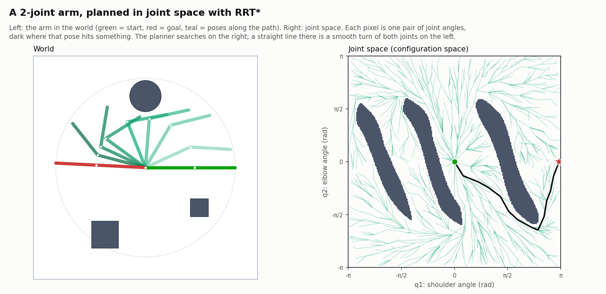

# Comparative Analysis of A*, RRT and RRT* for 2D Motion Planning

Team **RoboNexus** — AI for Robotics course project.

Implementation and benchmarking of three motion planning algorithms for a
simulated mobile robot in a dependency-free 2D environment.

## Status

Simulation world, all three planners, the benchmark harness and the evaluation
figures are **complete**, plus two extensions: learned sampling for RRT*, and
planning for a planar robot arm with N joints (see below). 84 unit tests
passing. Remaining work is the written
report and slides, which draw on `results/summary.md` and `results/chart_*.png`.

## Requirements

Python 3, NumPy, Matplotlib. Nothing else — no physics engine, no ROS,
no simulator.

```bash
pip install -r requirements.txt            # core project
pip install -r requirements-learning.txt   # + learned-sampling extension (SciPy, PyTorch)
```

The trained model (`learning/models/sampler_unet.pt`, 3.6 MB) is included, so
the evaluation and figures can be reproduced without retraining.

## Quick start

```bash
python demo.py                    # all five scenarios, writes path figures
python demo.py --scenario maze    # a single scenario
python demo.py --random 0.25      # a random world at 25% obstacle density

python run_benchmark.py           # full sweep (~3 min), then tables + charts
python run_benchmark.py --quick   # small sweep, sanity check
python run_benchmark.py --from-cache   # re-analyse the last run, no re-running

python arm_demo.py                # robot-arm planning figures -> results/arm/

python -m unittest discover -s tests -t . -v    # 84 tests (torch tests skip if absent)
```

`--from-cache` matters: the sweep takes minutes, and re-running it just to
restyle a chart would produce *different numbers* (different worlds, different
seeds), silently invalidating any figure already pasted into the report.
Analysis and plotting always work from the saved raw CSV.

## Layout

```
env/
    geometry.py      exact analytic primitives (point/segment/AABB distances)
    obstacles.py     RectObstacle, CircleObstacle
    environment.py   the world; the single source of truth on collisions
    grid.py          uniform grid discretisation used by A*
    generator.py     random worlds by density + five fixed scenarios
planners/
    base.py          shared plan() interface, metric schema, path verifier
    tree.py          search tree shared by RRT and RRT* (NumPy-backed queries)
    astar.py         A*   — Hart, Nilsson & Raphael 1968
    rrt.py           RRT  — LaValle 1998
    rrt_star.py      RRT* — Karaman & Frazzoli 2011
    samplers.py      uniform, heatmap and Informed RRT* sampling (pluggable)
arm/
    robot.py         planar N-joint arm and its forward kinematics
    collision.py     vectorised segment geometry for the links
    environment.py   joint-space planning problem (same interface as env/)
    problems.py      the 2-joint scenario and random arm worlds
    plot.py          world view and joint-space (C-space) figures
learning/            learned sampling: data, U-Net, training, evaluation
benchmark/
    runner.py        runs every planner over an identical world set
    analysis.py      aggregation, including the common-solved-subset logic
viz/
    plot.py          world, path, tree and expanded-cell rendering
    charts.py        the five benchmark figures
tests/               correctness tests for every claim the report makes
results/             generated data and figures (never hand-written)
```

## The planner interface

All three planners are interchangeable:

```python
from env import get_scenario
from planners import AStarPlanner, RRTPlanner, RRTStarPlanner

env = get_scenario("maze")
path, metrics = RRTStarPlanner(seed=1).plan(env)
```

`path` is a list of `(x, y)` waypoints from start to goal, or `None` on
failure. `metrics` is a flat dict with a fixed schema (see
`planners.base.METRIC_FIELDS`), so the harness writes rows straight to CSV
without special-casing any algorithm. Anything planner-specific (grid
resolution, step size, rewiring constant) is a **constructor** argument, never
a `plan()` argument.

## Results

450 runs: 3 density levels x 10 worlds x 5 trials x 3 planners, 10 s budget,
10 000 iteration cap. Full tables in `results/summary.md`; raw rows in
`results/benchmark_raw.csv`.

| planner | success | path length | vs. best | first path | total time | nodes |
|---|---|---|---|---|---|---|
| A* | 100% | 142.18 +/- 9.05 | 1.052x | 0.032 s | 0.032 s | 1 371 |
| RRT | 100% | 172.00 +/- 23.86 | 1.272x | **0.003 s** | 0.003 s | 199 |
| RRT* | 100% | **135.08 +/- 7.42** | **1.000x** | 0.004 s | 0.999 s | 7 435 |

By density (path length, common subset):

| density | A* | RRT | RRT* |
|---|---|---|---|
| sparse (10%) | 134.90 | 159.96 | **129.51** |
| moderate (20%) | 141.86 | 169.46 | **133.57** |
| cluttered (30%) | 149.78 | 186.58 | **142.16** |

### What the numbers say

**The expected ordering holds at every density: RRT\* < A\* < RRT.** RRT* is
27% shorter than RRT and 5% shorter than A*; it was the best planner on every
single instance (normalised length exactly 1.000x).

**RRT reaches a feasible path roughly 10x faster than A\*** (3 ms vs 32 ms
median) and explores ~7x fewer nodes — but pays for it with the longest paths,
and the most variable (+/-23.9 vs +/-7.4 for RRT*). That variance *is* the
non-optimality: RRT returns whatever it stumbles into.

**RRT\* finds its first path almost as fast as RRT** (4.3 ms vs 3.0 ms) — the
choose-parent and rewire steps cost very little up front. Its ~1.0 s total is
time spent *improving*, not searching, which is why the metric schema records
first-solution and total time separately. Quoting RRT*'s total runtime against
RRT's is the most natural way to get this comparison wrong.

**A\* degrades most sharply with density** (0.011 s to 0.047 s, 788 to 1 906
cells expanded), because obstacles force the heuristic to explore around them.
RRT* moves the other way — 8 472 to 6 350 nodes — since in denser worlds more
samples are rejected as colliding, so fewer survive into the tree.

**Where RRT\* overtakes A\* is visible in
[chart_convergence.png](results/chart_convergence.png):** it starts near RRT's
level, crosses A*'s line around iteration ~2 000, and keeps falling. Before
that crossing, A* is the better choice.

### Figures

| file | what it shows |
|---|---|
| `chart_success_profile.png` | share of runs solved within a given budget |
| `chart_path_length.png` | path length by density, +/-1 s.d. |
| `chart_time.png` | first-path to total-time span per planner |
| `chart_nodes.png` | search effort by density |
| `chart_convergence.png` | RRT*'s refinement vs the other two |
| `<scenario>_panels.png` | each planner's internals on one world |
| `<scenario>_overlay.png` | all three paths on one world |

## Extension: learned sampling for RRT*

A small U-Net predicts *where* near-optimal paths run on a given map, and
RRT* draws 90% of its samples from that prediction (10% stay uniform, which
keeps RRT*'s completeness and optimality guarantees). Everything lives in
`learning/`; the core planners only gained an optional `sampler=` argument
and stay PyTorch-free.

```bash
# needs PyTorch + SciPy in addition to NumPy / Matplotlib
python -m learning.dataset              # 10k train + 1k val problems (~10 s)
python -m learning.train                # 30 epochs, ~20 min on CPU
python -m learning.evaluate --tune      # choose the mix on VALIDATION maps
python -m learning.evaluate             # final run on the test sets (5 250 runs)
python -m learning.plots                # figures from the saved results
```

**Training target.** For each map, the cells through which some path at most
2% longer than optimal can pass (`learning/labels.py`; two Dijkstra searches,
one from the start and one from the goal, on a 16-connected 64x64 grid). It is
the obstacle-aware version of Informed RRT*'s ellipse. Start and goal are
randomised so the model cannot memorise "go along the diagonal".

**Test sets, never used in training:** 100 held-out random problems, the 30
main-benchmark worlds, and the 5 hand-designed scenarios (long walls, a
C-trap, a doorway: structure the random generator never produces).

**Baselines.** Besides plain (uniform) RRT*, the learned sampler is compared
with **Informed RRT\*** (Gammell et al., IROS 2014; `InformedSampler` in
`planners/samplers.py`). Once a path of length c exists, it samples only
inside the ellipse `|x - start| + |x - goal| <= c`, the only region where a
shorter path can pass. It needs no learning, but it knows nothing before the
first path and ignores obstacles. `RRT* + learned + informed` combines the
two: heatmap samples, kept only inside the ellipse.

**Results** (medians; `results/learned/eval_summary.md` has every number):

Iterations until within 5% of the best known cost (lower is better):

| test set | RRT* | Informed RRT* | RRT* + learned | learned + informed | exact Dijkstra (reference) |
|---|---|---|---|---|---|
| held-out random (100 problems) | 2 044 | 892 | 258 | **232** | 226 |
| main benchmark (30 worlds) | 2 354 | 1 792 | 552 | **544** | 498 |
| scenarios (5, unseen structure) | 2 124 | 1 718 | 625 | **580** | 510 |

- Learned sampling needs **3.4-7.9x fewer iterations** than plain RRT* and beats
  it at 1 000 iterations on **100 of 100** held-out problems and **29 of 29**
  benchmark worlds (Wilcoxon p < 1e-8 for both).
- **Learned beats Informed RRT\* early**: better at 1 000 iterations on 67% of
  held-out problems and all 29 benchmark worlds (p < 1e-8). Informed RRT*
  can't help before the first path, and on corner-to-corner worlds its first
  ellipse covers most of the map, so it starts slowly.
- **Given enough iterations, Informed RRT\* catches up**: at 5 000 iterations,
  learned and informed are tied on the held-out set (p = 0.87).
- **Combining them is best**: learned + informed beats Informed RRT* at 5 000
  iterations (p < 1e-5) and is the fastest real method on every set. Only the
  exact Dijkstra reference is faster.
- On the **maze**, uniform and Informed RRT* need 1 455 iterations for a first
  path; with learned sampling it takes 1 148 (exact Dijkstra: 627, so the
  network leaves room on unseen structure).

**Caveats, stated plainly:**

- *Wall-clock:* inference costs ~7 ms alone (12-42 ms in the parallel
  evaluation, depending on machine load). On these easy worlds uniform RRT*
  finds a first path in a few ms,
  so learned sampling is **slower to the first path in milliseconds** and wins
  only on iterations / convergence.
- *In 2-D you don't need the network:* the exact Dijkstra sampler is better
  and faster (~4 ms). 2-D serves as a testbed where the ideal answer is known,
  so the learning gap can be measured. The method is aimed at
  high-dimensional problems (robot arms) where no such grid can be built.
- *Failure case:* `cluttered_02` has a passage narrower than one grid cell.
  The network cannot see it, and with 90% of samples spent on its wrong guess,
  RRT* failed in 3 of 5 runs within 5 000 iterations (uniform: 5 of 5). This is
  the only world where learned sampling did worse. A lower mix, or a finer
  grid, would trade some speed-up for robustness.

Figures: `results/learned/learned_convergence.png`,
`learned_heatmaps.png` (prediction and trees on every scenario plus the
failure case), `learned_training.png`.

## Extension: planar robot arm (in progress)

The same RRT, RRT* and Informed RRT* code now plans for a planar arm with any
number of joints. Nothing in the planners is arm-specific: they talk to
`arm.ArmEnvironment` through the same five questions they ask the 2-D world
(sample, in bounds, state valid, motion valid, free volume). A configuration
is a tuple of joint angles, and path cost is total joint rotation in radians.

```python
from arm import random_arm_problem
from planners import RRTStarPlanner, InformedSampler

env = random_arm_problem(dof=5, seed=0)
path, metrics = RRTStarPlanner(step_size=0.5, goal_tolerance=0.5,
                               sampler=InformedSampler()).plan(env)
```



**What changed to make this work.** The search tree, steering, distance and
RRT*'s rewiring radius `gamma (log n / n)^(1/d)` now work in any dimension d,
and Informed RRT*'s ellipse becomes an N-D ellipsoid (rotation built with an
SVD, as in the paper). For d = 2 the original arithmetic is kept exactly: 60
saved runs from the learned-sampling evaluation reproduce to the last digit.

**Motion checking is guaranteed, not sampled at a guess.** When the joints
move by dq, no point of the arm moves further than `sum_i |dq_i| * R_i`
(R_i = length from joint i to the tip). The motion is split into steps small
enough that every in-between pose is within delta/2 of a checked pose, and the
checked poses must clear the obstacles by link radius + delta/2. So a motion
the check accepts cannot clip an obstacle between two checks. A test re-checks
accepted motions 20x more finely and never finds a collision.

**Status.** Stage 1 of 3 is done: arm model, collision checking, N-D planners,
figures. Next: (2) the scaling experiment, 2 to 7 joints, exact grid search vs
sampling; (3) a learned sampler that proposes good arm poses directly. Early
runs show high-joint random worlds are hard: some 6- and 7-joint worlds took
~20 000 iterations or went unsolved, and a "reach into a shelf slot" scenario
was dropped from this stage because no planner solved it in 20 000
iterations, so it is unconfirmed whether it can be solved at all.

## Design decisions worth defending in the viva

**Collision checking is exact, and shared.** `Environment.is_motion_valid`
measures true distance from the swept segment to each obstacle, so it cannot
tunnel through a thin wall. A sampled checker would have quietly favoured the
sampling planners, which take far longer steps than A*'s grid moves. Tested by
`test_no_tunnelling_through_thin_obstacle`.

**A\* gets no easier test than the others.** The grid supplies only the node
set; cell and move validity are resolved lazily through the same `Environment`
queries RRT calls. A success-rate gap is therefore a real algorithmic
difference, not an artefact of the collision model.

**The broad-phase speed-up is exact, not approximate.** Bounding-box rejection
made A* on the maze 82x faster (12.9 s to 0.16 s) with an identical path and an
identical collision-check count. Verified against brute force on 400 random
segments.

**Path length is averaged only over instances every planner solved.** If a
planner fails on the hard worlds, averaging it over "its own successes" scores
it only on the easy ones. `test_naive_mean_would_flatter_the_failing_planner`
builds exactly that trap and checks the common-subset average escapes it.
Failures are not hidden — they move to the success-rate metric, which owns them.

**Success rate is reported as a profile, not a bar.** At the full budget all
three reach 100%, so a bar chart of it would be three identical bars. The
metric only discriminates while the budget binds, so
`chart_success_profile.png` sweeps the budget instead — derived from the
recorded first-solution times, not a second experiment.

**The convergence median treats an unsolved run as infinitely long.** Averaging
only over runs that already have a path changes the population as the plot
moves right, and since early finishers are the lucky short-path ones, the
"median" *rises* even though no run ever gets worse. Holding unsolved runs at
infinity keeps the population fixed and the median genuinely monotone.

**Chart colours were computed, not chosen.** The three series use validated
categorical slots; worst all-pairs colour-vision-deficient separation is
Delta-E 9.2 (target >= 8), worst normal-vision separation 24.0 (floor >= 15).
One series sits below the 3:1 contrast floor, and the documented relief —
visible direct labels plus a table view — is why every mark carries its value
and why `summary.md` exists. `test_palette_is_the_validated_one` guards it.

**RRT stops at its first solution.** The textbook formulation; leaving it
unmodified is what makes the RRT vs RRT* gap a measurement rather than a tuning
artefact.

**RRT\*'s rewiring radius is derived, not tuned.** `r(n) = min(gamma * (log n / n)^(1/2), eta)`
with gamma computed from the environment's free area per Karaman & Frazzoli's
gamma* bound.

**Rewiring propagates costs to descendants.** A common shortcut is to skip
this, leaving stale costs that cause the algorithm to reject genuinely better
rewirings later. `Tree.set_parent` propagates; there is a test for it.

**Nothing is reported that isn't verified.** Every path a planner claims is
re-checked by `verify_path` before any metric is recorded — in the demo, in the
benchmark harness, and in the tests.

## Metrics

| field | meaning |
|---|---|
| `path_length` | total Euclidean length of the returned path |
| `time_sec` | wall-clock planning time |
| `success` | found a valid path within the time budget |
| `nodes` | A*: cells expanded, RRT/RRT*: nodes in the tree |
| `iterations` | A*: pops, RRT/RRT*: sample iterations |
| `state_checks` / `motion_checks` | collision queries (machine-independent cost) |
| `first_solution_*` | time/length/iteration of the **first** path found |

## Scenarios

| name | what it isolates |
|---|---|
| `empty` | sanity baseline — the optimum is the straight line (127.28) |
| `cluttered_discs` | many homotopy classes; where RRT* gains most over RRT |
| `maze` | long detours, no shortcut; path *quality* vs feasibility |
| `narrow_gap` | the sampling weakness — a doorway RRT rarely samples into |
| `bug_trap` | concave pocket; penalises naive goal bias |

On `empty`, where the true optimum is known exactly, RRT* returns 127.47 —
0.15% above it. That is the clearest single piece of evidence that the rewiring
is implemented correctly.

## Reproducibility

`results/benchmark_meta.json` records the full configuration and every world
used (seed, density, obstacle count, start/goal). Planner runs are seeded per
trial, so RRT and RRT* see the same random stream on the same world.

Re-running the sweep reproduces every **path length and node count exactly**
(135.08 / 142.18 / 172.00 across two independent runs); only the wall-clock
timings move, by a few percent, since those depend on the machine. So quote
lengths as exact and timings as approximate — and prefer the `motion_checks`
column when a machine-independent cost measure is wanted.

`--quick` writes to separate `*_quick` files. Without that it would overwrite
the headline dataset with a handful of throwaway rows, and the next
`--from-cache` would silently rebuild every table and figure from them.

## Not in scope

Learned sampling bias, dynamic obstacles, 3D / high-DOF planning, ROS2
integration, hardware deployment. Documented as Future Work.
